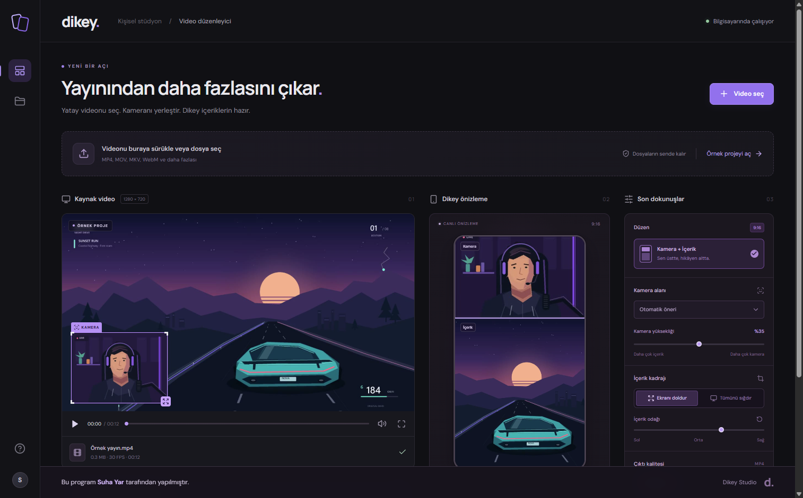

# Dikey Studio

**Yataydan dikeye, tek bir stüdyoda.** Yayın kayıtlarını kamera üstte, içerik altta olacak şekilde Reels, Shorts ve TikTok için dikey MP4 videolara dönüştüren Windows uygulaması.

**Bu program Suha Yar tarafından yapılmıştır.**



## İndir ve kullan

1. [Son sürümün indirme sayfasını](https://github.com/graphicsuha-debug/YatayToDikey/releases/latest) açın.
2. `Dikey-Studio-Setup-1.0.0-x64.exe` kurulum dosyasını indirin ve çalıştırın.
3. Kurulumu tamamlayın. Masaüstündeki **Dikey Studio** kısayoluyla uygulamayı açın.

**Windows 10 / 11, 64 bit.** Kurulum; uygulama penceresini, video motorunu, Python çalışma ortamını ve FFmpeg/ffprobe araçlarını içerir. Kullanıcıların ayrıca Python, Node.js, FFmpeg veya bir tarayıcı bileşeni kurmasına gerek yoktur. Kurulum dosyasını indirdikten sonra kurulum ve video işleme internet bağlantısı gerektirmez.

## Özellikler

- Yatay videodan **9:16** dikey video.
- Örnek karelerdeki yüzlerden otomatik kamera alanı önerisi; sürükleme, boyutlandırma ve dört köşe hazır konumları.
- Kamera üstte, içerik altta; ayarlanabilir kamera yüksekliği ve içerik odağı.
- İçeriği kırparak ekranı doldurma veya tamamını sığdırma.
- Başlangıç/bitiş saniyeleriyle kesit seçimi.
- **720 × 1280** veya **1080 × 1920**, **30/60 FPS**, H.264 + AAC MP4.
- Kaynak sesi koruma veya sessiz çıktı.
- İlerleme, iptal, kalıcı çıktı geçmişi ve dosyayı istediğiniz konuma kaydetme.
- Filigransız çıktı; özgün ve hareketli örnek proje.

## Kullanım

Videonuzu seçin veya sürükleyip bırakın. Mor kamera çerçevesini kontrol edin; gerekirse kameranızın çevresine taşıyıp boyutlandırın. Dikey önizleme ayarlarınızı anında gösterir. Kesit ve kaliteyi seçip **Dikey videoyu oluştur** düğmesine basın. İşlem tamamlandığında **Videonu indir** ile dosyayı kaydedin. Önceki çıktılar **Çıktılarım** bölümünde bulunur.

Kamera tespiti bir tahmindir; her yayın düzeninde tam kamera kenarlarını bulamayabilir. Seçilen alan video boyunca sabittir; hareketli yüz takibi veya otomatik önemli an seçimi yapılmaz. Bazı kaynak biçimlerinde tarayıcı motoru oynatma yerine kare önizlemesi gösterir; desteklenen kaynaklar yine MP4'e dönüştürülebilir.

## Yerel dosyalar

Videolar buluta gönderilmez. Kaynak kopyaları, çıktılar ve günlükler kullanıcıya ait uygulama verisi klasöründe tutulur. Masaüstü sürümünde varsayılan konum `%APPDATA%\Dikey Studio\data` klasörüdür. Kurulum klasörüne yazılmaz.

Uzun kayıtlar için kaynak ve çıktıları birlikte tutacak boş disk alanı gerekir. Tek dosya sınırı 20 GB, süre sınırı 24 saattir. İşlem süresi kayıt uzunluğu, kalite ve bilgisayar hızına bağlıdır. Devam eden iş varken çıkıştan önce uyarı gösterilir; tamamlanmış çıktılar korunur.

## Kaynak koddan geliştirme

Yalnızca geliştiriciler için: Windows x64, Node.js 24, Python 3.13 veya 3.14 ve `ffmpeg`/`ffprobe` gerekir.

```powershell
python -m venv .venv
.\.venv\Scripts\python.exe -m pip install -r requirements.txt
npm.cmd ci
npm.cmd run build
.\.venv\Scripts\python.exe -m backend.app
```

`http://127.0.0.1:4318` adresini açın. `Baslat.bat` bu geliştirme akışını otomatik hazırlar. Canlı arayüz geliştirmesi için ikinci terminalde `npm.cmd run dev` çalıştırın.

Masaüstü penceresini geliştirme modunda açmak için:

```powershell
node node_modules/electron/install.js
npm.cmd run desktop
```

## Kurulum dosyasını üretme

Dağıtımdaki küçük FFmpeg derlemesi `scripts/build-ffmpeg.sh` ile Ubuntu veya WSL üzerinde hazırlanır. Tarif, FFmpeg ve x264 kaynaklarını sürüm ve SHA-256 değerleriyle sabitler. GitHub Actions Linux derlemesini Windows paketleme işine aktarır.

```bash
sudo apt-get update
sudo apt-get install -y gcc-mingw-w64-x86-64-posix nasm make pkg-config curl xz-utils
bash scripts/build-ffmpeg.sh build/ffmpeg
```

Windows'ta FFmpeg çıktıları `build\ffmpeg` içine yerleştirildikten sonra:

```powershell
npm.cmd run dist:win
```

Komut arayüzü derler, video motorunu bağımsız EXE haline getirir, lisansları toplar ve tüm bileşenleri NSIS kurulum dosyasına paketler. Sonuç `release\Dikey-Studio-Setup-1.0.0-x64.exe` konumundadır. Yayımlanan kurulumlar için projedeki sabit FFmpeg derlemesini kullanın; diğer dağıtımların lisans ve kaynak gereksinimleri farklı olabilir.

## Testler

```powershell
.\.venv\Scripts\python.exe -m pip install -r backend/requirements-test.txt
.\.venv\Scripts\python.exe -m unittest backend.test_app -v
npm.cmd run build
```

Testler gerçek video çıktısının çözünürlüğünü, süresini, sesini, kamera/içerik piksellerini, iptali, dosya aralığı akışını ve yeniden açılışta çıktı geçmişini doğrular. Paketlenmiş EXE ayrıca Python ve FFmpeg bulunmayan bir `PATH` ile test edilir.

Masaüstü başlangıç testi için `DIKEY_SMOKE_TEST_DIR` ortam değişkenini bir test klasörüne ayarlayıp EXE'yi çalıştırın. Uygulama gizli pencerede açılır, ayrı kullanıcı verisi kullanır, `smoke.json` ve `smoke.png` oluşturur, kendi süreçlerini kapatır.

## GitHub sürümleri

`Windows installer` iş akışı elle veya `v*` etiketi gönderildiğinde çalışır. Kurulum, SHA-256 doğrulaması ve FFmpeg/x264 kaynak paketi derleme çıktıları olarak saklanır. Herkese açık sürüme EXE ile **aynı derlemenin kaynak paketini ve checksum dosyasını birlikte** ekleyin. Kişisel videolar, günlükler, sanal ortamlar ve geçici derleme dosyaları depoya dahil edilmez.

Kurulum kod imzalama sertifikasıyla imzalı değildir. Windows yayımlayanı doğrulanmamış gösterebilir. Dosyanın SHA-256 değerini sürümdeki `SHA256SUMS.txt` ile karşılaştırabilirsiniz.

## Üçüncü taraf bileşenler

Lisanslar ve kaynak bilgileri [THIRD_PARTY_NOTICES.md](THIRD_PARTY_NOTICES.md) ve kurulumdaki `resources\LICENSES` klasöründedir. Üçüncü taraf bileşenlerin telif ve lisansları kendi sahiplerine aittir.

© 2026 Suha Yar.
